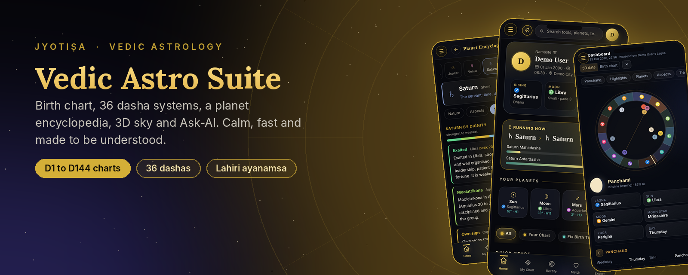
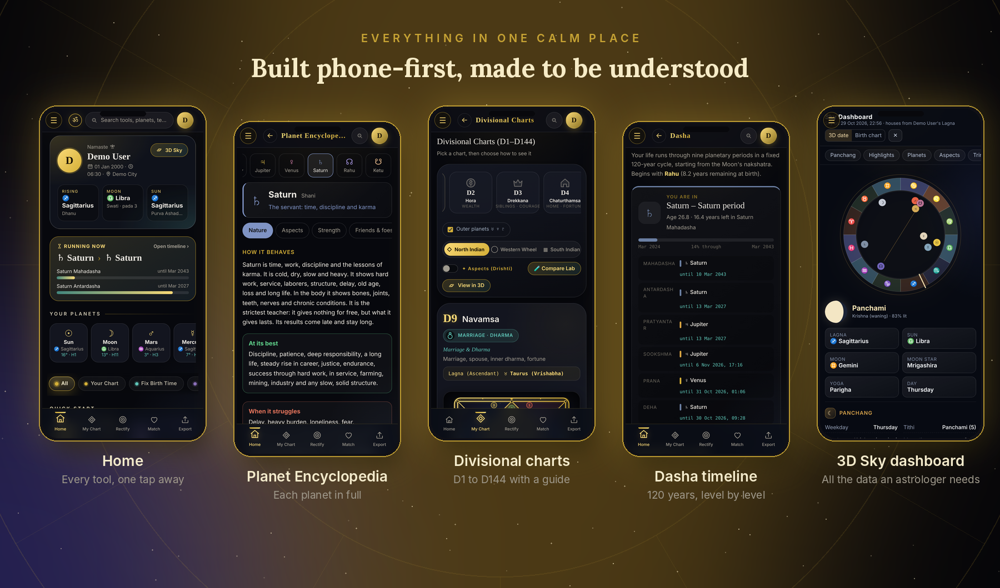
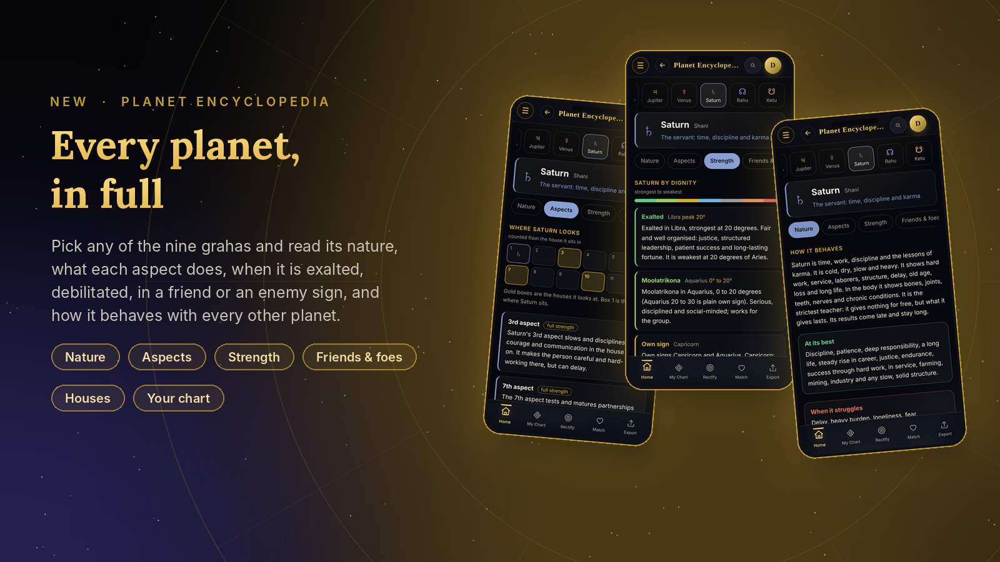
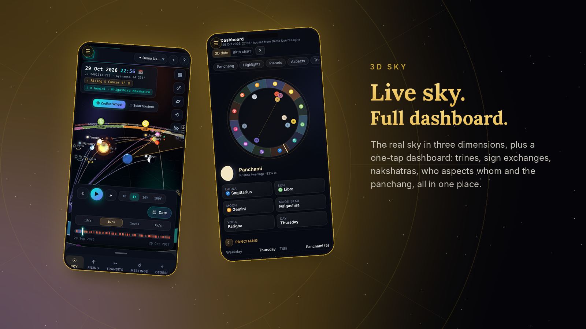
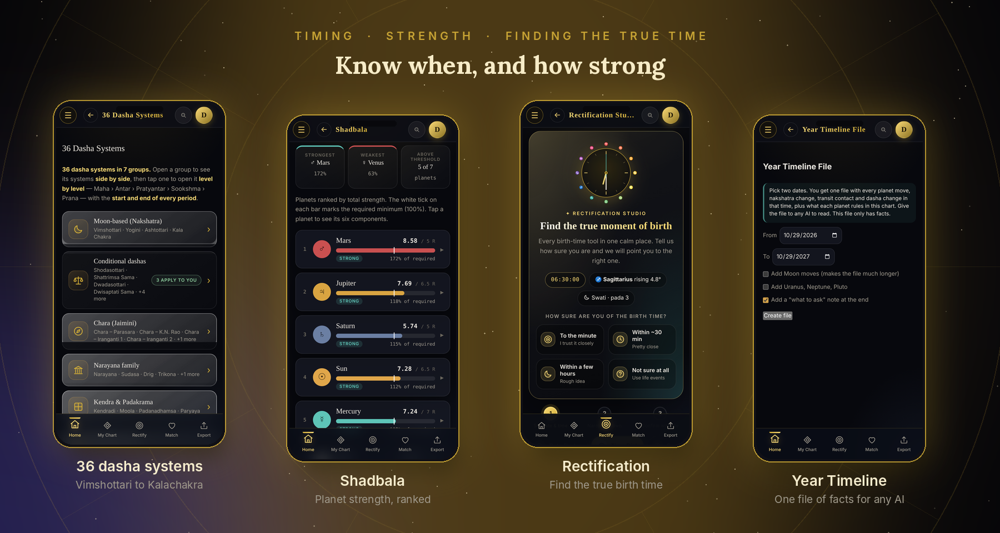
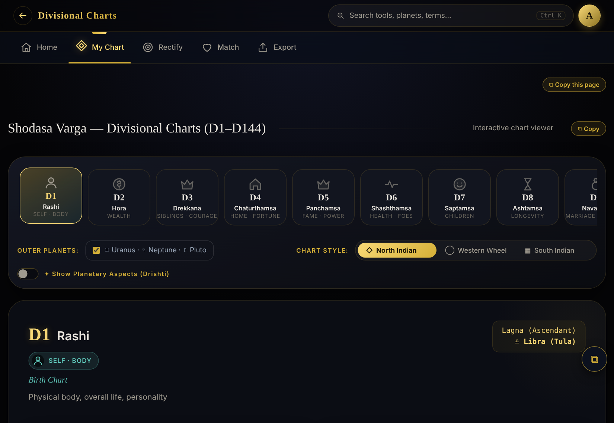
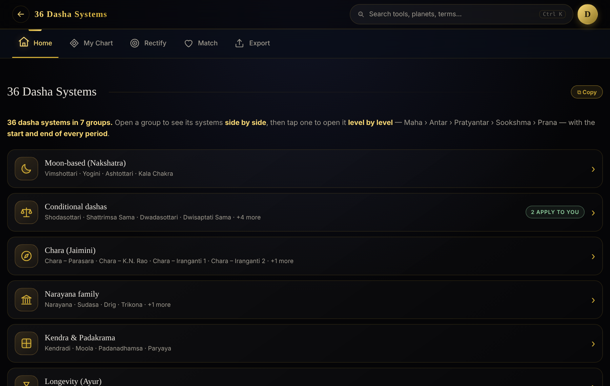

<div align="center">



<br>

### A calm, dark-and-gold toolkit for Vedic astrology
**Runs fully in your browser. No sign-up needed. Made to be understood.**

<br>


[**Features**](#-whats-inside) · [**Gallery**](#-gallery) · [**Run it**](#-run-it) · [**How it's built**](#-how-its-built) · [**Contribute**](#%EF%B8%8F-working-on-it)

<sub>All screenshots use a made-up demo profile.</sub>

</div>

---

## ✨ Why it feels different

| | |
|---|---|
| 🧘 **Calm** | Dark and gold, no jumping or heavy animation. Plain words instead of jargon. |
| 📱 **Phone first** | Every tool works from 360 px wide. Open it and it works. |
| 🔒 **Private** | Charts stay on your device. Sign in only if you want them on every device. |
| 🔎 **Search first** | One search bar (`Ctrl/Cmd + K` or `/`) finds any tool, any placement in your chart and the meaning of any term. |
| 📚 **Sourced** | Rules are tagged *From the texts* or *Common practice*. No yoga or saham is added without a source. |

<div align="center"></div>

---

## 🪐 What's inside

| | Feature | What you get |
|---|---|---|
| 🗺️ | **Birth chart** | Planets, houses, dignity, combustion, aspects, yogas, Shadbala, Ashtakavarga, Bhava Chalit, 23 special lagnas |
| 📚 | **Planet Encyclopedia** *(new)* | One full page per graha: nature, every aspect, exalted / debilitated / friend / enemy, how it acts with each planet, each house |
| 🧩 | **Divisional charts D1 to D144** | Every classical varga, with a full "how to read this chart" guide for each one |
| 🎡 | **36 dasha systems** | Vimshottari, Yogini, Chara, Narayana, Kalachakra and more, side by side, down to Prana |
| 🎯 | **Rectification studio** | Find the true birth time: dial, scan, sandhi tables, transit timer, life-event checker, Date Finder |
| 🔮 | **Timing and cycles** | Panchanga, Vedic birthday, Tithi Pravesh, transits, Sade Sati, Life Activation, Fate Meter, Year Timeline File |
| 💞 | **Kundali matching** | Ashtakoota 36-point match with Manglik check |
| 🌌 | **3D Sky** | The live sky in three dimensions, a one-tap **Dashboard** with all the data an astrologer needs, and a Triggers tab |
| 🤖 | **Ask-AI** | Pick a topic, get ready-made questions with your exact chart details |
| 📝 | **Jyotish Notebook** | Notes, templates and client cards |
| 🔗 | **Share and export** | Share by link or QR, copy a full report, export or import profiles |

---

## 🖼️ Gallery

<div align="center"></div>

<br>

<div align="center"></div>

<br>

<div align="center"></div>

<br>

<table>
<tr>
<td width="50%"><br><sub><b>Start in seconds</b>: a clean three-step form</sub></td>
<td width="50%"><br><sub><b>Your profile</b>: rising, moon, sun and star at a glance</sub></td>
</tr>
<tr>
<td width="50%"><br><sub><b>Divisional charts</b>: D1 to D144</sub></td>
<td width="50%"><br><sub><b>36 dasha systems</b>, grouped in 7 families</sub></td>
</tr>
</table>

---

## 🚀 Run it

**Online:** the app is deployed from this repo with Vercel, so every push to `main` goes live.

**On your computer:**

```bash
cd vedic-astro-suite
python3 -m http.server 8000      # then open http://localhost:8000
```

Prefer a single file with no server? Open `vedic-astro-suite/dist/vedic-astro-suite-readable.html` directly in your browser.

---

## 🧱 How it's built

```
vedic-astro-suite/
├─ index.html        shell: loader and app switcher
├─ apps/
│   ├─ birth-chart/  the main app (charts, dashas, strengths, rectification, search)
│   ├─ sky3d/        3D Sky (Three.js) and its dashboard
│   ├─ notepad/      Jyotish Notebook
│   └─ developer/    developer card
│                    each app: index.html + numbered css/ + js/ files
├─ shared/ vendor/   code shared by the apps, third-party libraries
├─ tools/ tests/     build, index and test scripts
├─ docs/             handoff, release checklist, research notes
└─ dist/             generated single-file builds (never edit)
```

Plain files with no framework or bundler, loaded in number order, so anyone can find and change a feature. `python3 build.py` rebuilds everything and checks that the file map in `STRUCTURE.md` is complete.

Other folders in this repo: `door-site/` (the paid-access site), `archive/` (older, separate projects), and a few single-file copies of the app at the top level.

---

## 🛠️ Working on it

1. Read [`vedic-astro-suite/AI_GUIDE.md`](vedic-astro-suite/AI_GUIDE.md): where to look for each kind of change.
2. See [`vedic-astro-suite/STRUCTURE.md`](vedic-astro-suite/STRUCTURE.md) for the map of every file.
3. Change code, then run `python3 build.py`, `python3 tests/syntax_check.py` and the test for your feature in `vedic-astro-suite/tests/`.
4. Push to both `main` and `Root`.

---

## 🙏 Notes

Calculations use the Lahiri ayanamsa. Some dasha systems are interpreted differently by different schools, and the app marks those as *varies*. Use it as a learning and research aid, and check important results with a trusted astrologer.

<div align="center">

Made with care by **Madhu Yadav**

</div>
