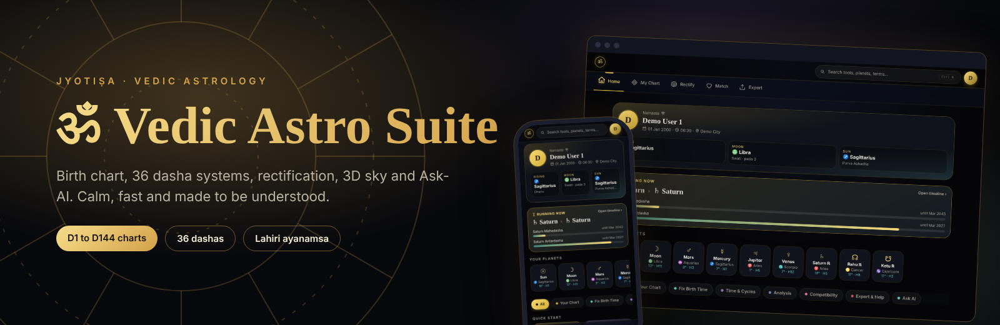
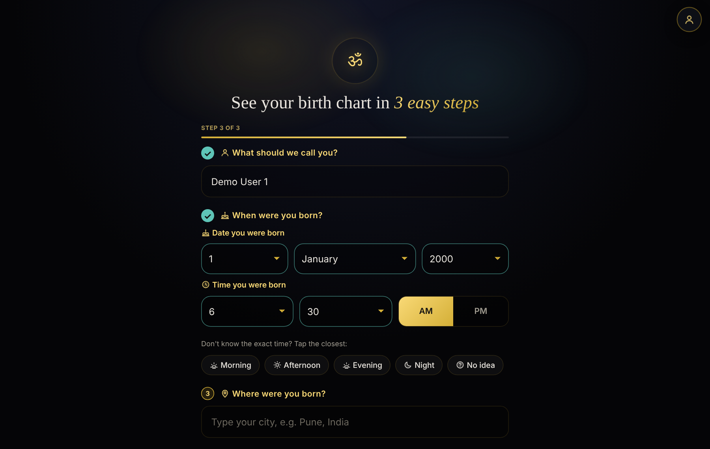
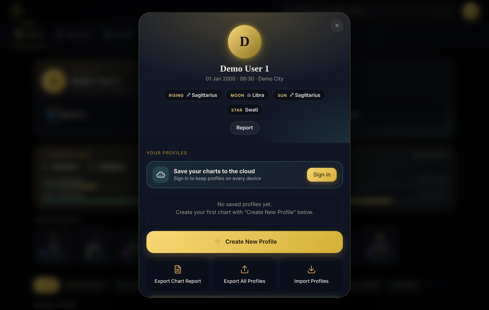
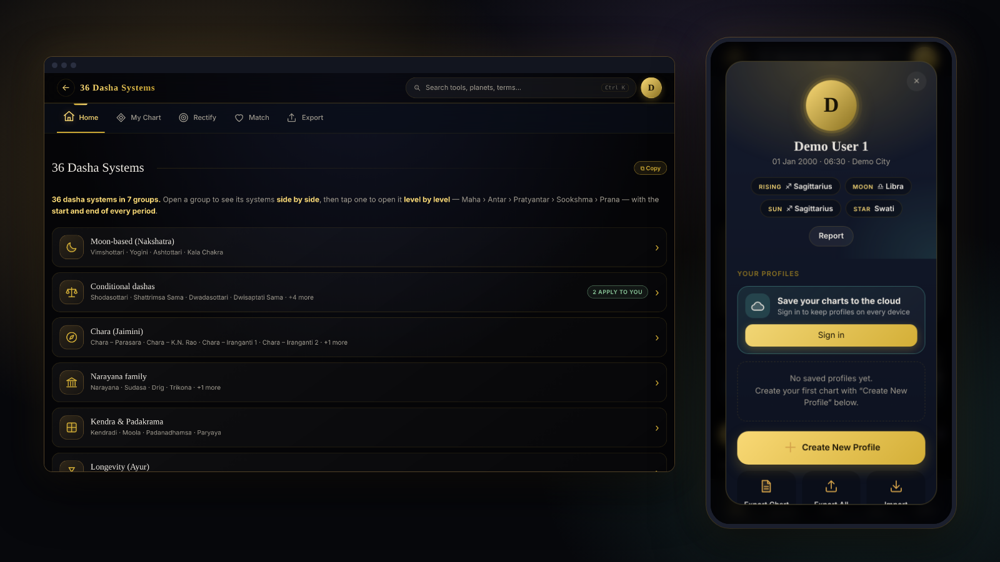

<div align="center">



<br>

**A calm, dark-and-gold toolkit for Vedic astrology.**


<sub>Screenshots use a made-up demo profile.</sub>

</div>

---

## ✨ Why it feels different

- **Made for real astrologers *and* beginners.** The first page asks only three things: name, birth date and time, place. Everything else is explained in plain words.
- **Your data stays with you.** Charts are saved on your device. Sign in only if you want them on every device.
- **Fast and light.** No heavy framework. Open it and it works, even on a phone.
- **Search first.** One search bar finds any tool, any placement in your chart, and the meaning of any term.

<table>
<tr>
<td width="50%"><br><sub><b>Start in seconds</b>: a clean, full-screen form</sub></td>
<td width="50%"><br><sub><b>Your profile</b>: rising, moon, sun and star at a glance</sub></td>
</tr>
</table>

## 🪐 What's inside

| | Feature | What you get |
|---|---|---|
| 🗺️ | **Birth chart** | Planets, houses, aspects, yogas, Shadbala, Ashtakavarga, Bhava Chalit, 23 special lagnas |
| 🧩 | **Divisional charts D1 to D144** | Every classical varga, plus nested D81 / D108 / D144 and Rasi Tulya Navamsa with Arudha labels |
| 🎡 | **36 dasha systems** | Vimshottari, Yogini, Chara, Narayana, Kalachakra and more, grouped in 7 families, compared side by side, drilled down to Prana |
| 🎯 | **Rectification studio** | Find the true birth time: dial, scan, sandhi tables, transit timer, life-event checker, date finder |
| 🔮 | **Timing & cycles** | Panchanga, Vedic birthday, Tithi Pravesh, transits and Sade Sati, Life Activation, Fate Meter |
| 💞 | **Kundali matching** | Ashtakoota 36-point match with Manglik check |
| 🌌 | **3D Sky** | Live sky in three dimensions, plus a dasha and double-transit **Triggers** tab |
| 🤖 | **Ask-AI** | Pick a topic, get ready-made questions with your exact chart details |
| 🔗 | **Share & export** | Share by link or QR, copy a full report, export or import profiles |

<div align="center"></div>

## 🚀 Run it

**Online:** the app is deployed from this repo with Vercel, so every push to `main` goes live.

**On your computer:**

```bash
cd vedic-astro-suite
python3 -m http.server 8000      # then open http://localhost:8000
```

Prefer a single file with no server? Open `vedic-astro-suite/dist/vedic-astro-suite-readable.html` directly in your browser.

## 🧱 How it's built

```
vedic-astro-suite/
├─ index.html        shell: loader and app switcher
├─ apps/             sky3d · birth-chart · notepad · developer
│                    (each: index.html + numbered css/ + js/ files)
├─ shared/ vendor/   code shared by the apps, third-party libraries
├─ tools/ tests/     build, index and test scripts
└─ dist/             generated single-file builds (never edit)
```

Plain files, loaded in number order, so anyone can find and change a feature. `python3 build.py` rebuilds everything and checks that the file map in `STRUCTURE.md` is complete.

## 🛠️ Working on it

1. Read [`vedic-astro-suite/AI_GUIDE.md`](vedic-astro-suite/AI_GUIDE.md): where to look for each kind of change.
2. See [`vedic-astro-suite/STRUCTURE.md`](vedic-astro-suite/STRUCTURE.md) for the map of every file.
3. Change code, then run `python3 build.py` and the tests in `vedic-astro-suite/tests/`.
4. Push to both `main` and `Root`.

## 🙏 Notes

Calculations use the Lahiri ayanamsa. Some dasha systems are interpreted differently by different schools, and the app marks those as *varies*. Use it as a learning and research aid, and check important results with a trusted astrologer.

<div align="center">

Made with care by **Madhu Yadav**

</div>
